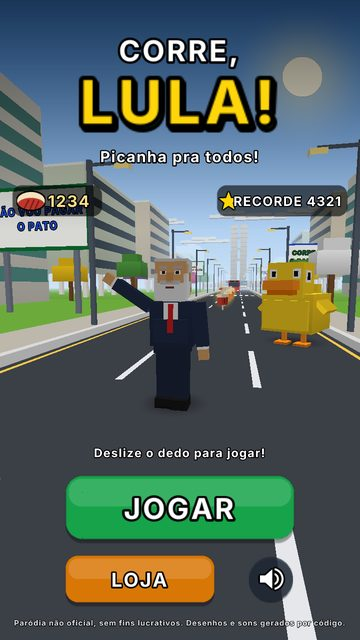
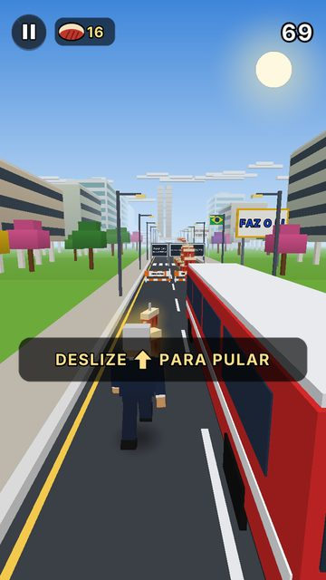
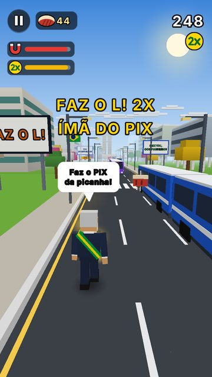
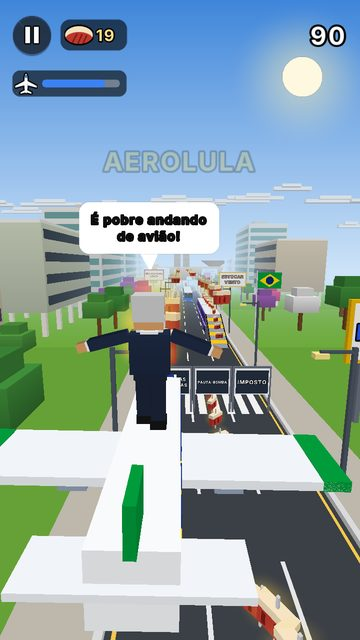
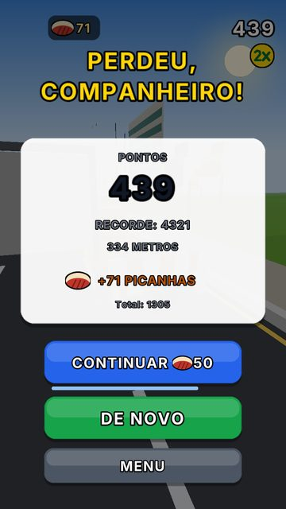
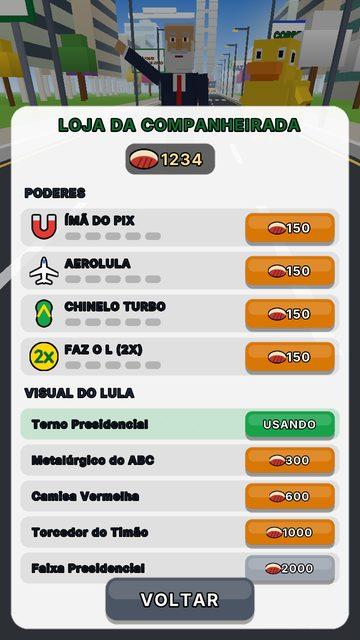

# Corre, Lula! 🏃‍♂️🥩🦆

Corredor infinito em 3D (estilo "endless runner" de 3 faixas) em que o presidente
Luiz Inácio Lula da Silva corre pela Esplanada dos Ministérios fugindo do Pato
amarelo, pegando picanhas e passando por memes no caminho.

> **Paródia não oficial, sem fins lucrativos.** Não tem ligação com nenhum político,
> partido, empresa ou com outros jogos. Personagens, cenário, sons e música são
> desenhados e sintetizados por código.

**APK pronto:** [`dist/CorreLula.apk`](dist/CorreLula.apk) (cerca de **100 KB**)

| Menu | Corrida | Poderes | AeroLula | Derrota | Loja |
|---|---|---|---|---|---|
|  |  |  |  |  |  |

*As imagens foram geradas pelo renderizador de testes do desktop (`desktop-test/`),
que reproduz o desenho do jogo em software; no celular o desenho é feito pela GPU.*

## Como instalar

1. Baixe `dist/CorreLula.apk` no celular.
2. Abra o arquivo e permita "instalar apps desconhecidos" para o navegador ou o gerenciador de arquivos.
3. Instale e jogue. Não pede nenhuma permissão.

Requisitos: Android 4.0 ou mais novo (API 14+) com OpenGL ES 2.0, ou seja, praticamente qualquer celular.

## Como jogar

| Gesto | Ação |
|---|---|
| Deslizar ← → | trocar de faixa |
| Deslizar ↑ | pular |
| Deslizar ↓ | abaixar e deslizar (no ar, desce rápido) |
| Voltar | pausar |

Também funciona com teclado ou controle: setas / WASD, Enter para confirmar.

- **Picanhas** são as moedas. Elas ficam guardadas e compram melhorias na loja.
- **Barreira baixa** ("OBRA DO PAC"): pule.
- **Faixa alta** ("FAKE NEWS", "JUROS ALTOS"...): abaixe.
- **Ônibus parados**: desvie, ou suba pela rampa e corra em cima deles.
- **Trem-bala** (branco com faixa vermelha e faróis acesos, vem na sua direção): saia da faixa!
- Bater de lado faz você **tropeçar**: o Pato chega perto. Tropeçar de novo antes de
  ele se afastar e o Pato te pega.
- Na derrota dá para **continuar** pagando picanhas (50, 100, 200).

### Poderes

| Poder | Efeito |
|---|---|
| Ímã do PIX | puxa as picanhas próximas |
| AeroLula | Lula voa no avião presidencial pegando picanhas no ar |
| Chinelo Turbo | pulo muito mais alto (dá para pular em cima dos ônibus) |
| Faz o L! 2X | pontos em dobro (e Lula ganha a faixa presidencial) |

Na **loja** cada poder pode ser melhorado 5 vezes (+1,5 s por nível), e há visuais
para o Lula: Terno Presidencial, Metalúrgico do ABC, Camisa Vermelha, Torcedor do
Timão e Faixa Presidencial.

### Memes no caminho

Outdoors ("FAZ O L", "O AMOR VENCEU", "ESTOCAR VENTO", "ATINGIU A META? DOBRA A META!",
"TREM-BALA: EM BREVE (DESDE 2010)", "TAXA DAS BLUSINHAS", "É VERDADE ESSE BILETE"...),
ônibus indo para Garanhuns, São Bernardo e Vila Euclides, barracas de "picanha do povo",
o Pato gigante, balões de fala do Lula ("Companheiros e companheiras!", "Faz o PIX da
picanha!", "É pobre andando de avião!"), metas que dobram a cada distância, trombone
triste na derrota e o recorde "NUNCA ANTES NA HISTÓRIA DESTE PAÍS!".

## Por que é tão leve

- Nada de engine nem bibliotecas: Java puro + OpenGL ES 2.0, sem AndroidX.
- Nenhum arquivo de imagem, modelo ou áudio dentro do jogo. Os modelos 3D são caixas
  geradas por código; a fonte e os ícones são desenhados na inicialização; efeitos
  sonoros e a música (um baião original) são sintetizados em memória.
- O cenário é gerado em blocos de 30 m, cada um enviado à GPU uma vez só; o mundo inteiro
  usa por volta de 150 chamadas de desenho por quadro.
- A resolução interna é limitada a 720 px no lado menor (economiza GPU e bateria em telas grandes).
- O laço do jogo praticamente não cria objetos novos (evita travadas do coletor de lixo).
- R8 encolhe e otimiza o código: o `classes.dex` tem cerca de 88 KB.

## Compilar

Precisa de JDK 17+ e do Android SDK (build-tools e `platforms/android-35`). Não usa Gradle.

```bash
ANDROID_HOME=/caminho/do/sdk ./build.sh
# gera dist/CorreLula.apk
```

O script cria uma chave de assinatura em `keystore/` na primeira vez. Essa pasta não vai
para o repositório: um APK compilado por outra pessoa terá outra assinatura e, para instalar
por cima, é preciso desinstalar a versão anterior antes.

Para gerar os ícones de novo: `python3 tools/make_icon.py` (usa Pillow).

## Testes no desktop

`desktop-test/` roda o mesmo código do jogo no PC, sem Android:

- `SoftGfx`: rasterizador em software que imita o backend OpenGL e salva capturas PNG.
- `Harness shots <pasta> <largura> <altura>`: tira capturas de menu, corrida, poderes, derrota, loja e pausa.
- `Harness smart <corridas> <segundos>`: um bot que testa jogadas à frente e verifica se o gerador de fases é justo
  (no último teste, 57 de 60 corridas de 5 minutos chegaram ao fim na velocidade máxima).
- `Harness audio <pasta>`: exporta todos os sons e a música em WAV.

```bash
mkdir -p /tmp/dt && javac -encoding UTF-8 -d /tmp/dt \
  src/com/monolito/correlula/{Mat,Gfx,MeshBuilder,Font,Batch,World,Memes,Models,Scenery,Synth,Game}.java desktop-test/*.java
java -Djava.awt.headless=true -cp /tmp/dt com.monolito.correlula.Harness shots /tmp 540 1170
```

## Estrutura

| Arquivo | O que faz |
|---|---|
| `World.java` | física, colisões, picanhas, poderes e gerador de fases (sem Android) |
| `Game.java` | estados, câmera, desenho, HUD, menus e loja (sem Android) |
| `Scenery.java` | Esplanada gerada em blocos: pista, ipês, prédios, outdoors |
| `Models.java` | Lula, Pato, ônibus, trem-bala, rampas, avião, Congresso |
| `Font.java` / `Batch.java` | atlas de texto e ícones, desenho de texto 2D/3D |
| `Synth.java` | efeitos e música sintetizados |
| `Memes.java` | todas as frases |
| `MainActivity.java`, `GLBackend.java`, `Audio.java`, `AndroidPainter.java` | a parte específica do Android |
